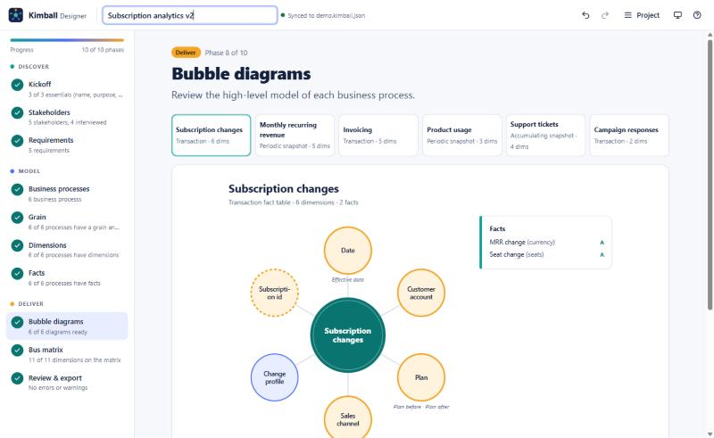
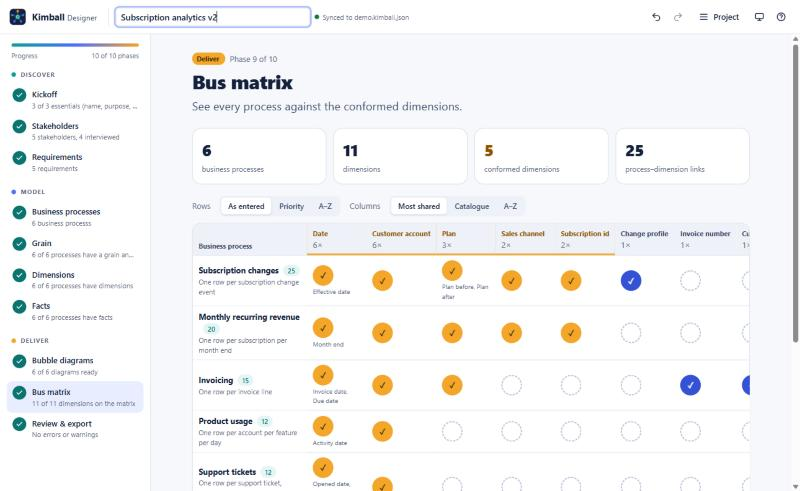
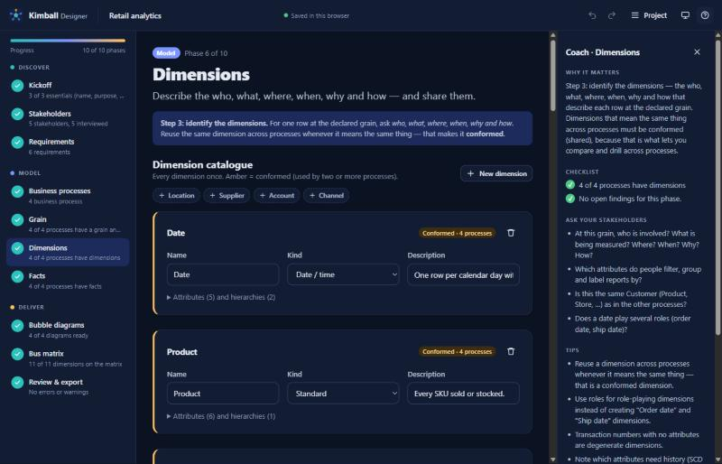

<p align="center">
  <picture>
    <source media="(prefers-color-scheme: dark)" srcset="brand/logo-lockup-dark.svg">
    
  </picture>
</p>

<p align="center">
  <strong>From first interview to bus matrix.</strong><br>
  A Claude skill and a guided web UI that lead developers through Kimball business-requirements gathering<br>
  and produce <b>bubble diagrams</b> and an <b>enterprise bus matrix</b>.
</p>

<p align="center">
  <a href="https://kimball.kristinn.eu"></a>
  <a href="https://github.com/kristinnthor/Kimball-designer/actions/workflows/ci.yml"></a>
  <a href="LICENSE"></a>
  <a href="https://github.com/kristinnthor/Kimball-designer/issues/1"></a>
</p>

---

## Why

Most dimensional models fail before the first table is created: the team never agreed on the **business processes**, the **grain**, or which **dimensions must be conformed**. Ralph Kimball's answer is a short, disciplined requirements process that ends in two artefacts everyone can read:

| Artefact | What it shows |
|---|---|
| **Bubble diagram** (one per business process) | The process / fact table in the middle, the dimensions that describe it around it, the grain underneath. |
| **Enterprise bus matrix** | Business processes (rows) × conformed dimensions (columns). The architecture plan for the whole warehouse. |

Kimball Designer turns that process into a guided experience — in Claude, in your browser, or both at once.

## How it works

```
 Discover                         Model                                         Deliver
 ───────────────────────────      ──────────────────────────────────────────    ─────────────────────────────────
 1 Kickoff                         4 Business processes   6 Dimensions           8  Bubble diagrams
 2 Stakeholders & interviews       5 Grain                7 Facts & measures     9  Bus matrix
 3 Requirements                                                                  10 Review & export
```

- **Claude skill** — Claude interviews you phase by phase, asks a few focused questions at a time, records the answers in a `*.kimball.json` project file, validates the model against Kimball best practices and renders the deliverables.
- **Guided UI** — a phase-by-phase wizard with a coach panel, live bubble diagrams and an interactive bus matrix. Runs fully offline from a single HTML file, or online at [kimball.kristinn.eu](https://kimball.kristinn.eu).
- **Live sync** — `kimball serve` opens the UI on the *same* project file Claude edits, so you can talk to Claude and watch the diagrams update, or click in the UI and let Claude pick up your changes.
- **Deliverables** — requirements document (Markdown), bus matrix (Markdown / CSV / HTML), bubble diagrams (SVG / PNG / Mermaid) and the project JSON.
- **Help and demos** — a built-in Help page (the **?** button) with guided demos, a guide to every deliverable, a glossary and an FAQ.

## What you get

At the end you have an agreed, documented high-level dimensional design, the blueprint Kimball asks for before anyone builds a table:

- **A shared language:** agreed business processes, grain and dimensions, which is where most warehouse rework comes from.
- **A prioritised first release:** every process scored on business value × feasibility.
- **An architecture that grows without rework:** the bus matrix shows which conformed dimensions to build once and share.
- **Traceability and honest unknowns:** every business question linked to a process; assumptions and open questions recorded with owners.
- **A head start on the build:** grain, fact table types, facts with additivity and dimensions with roles feed straight into the detailed design.

The [user guide](docs/USER-GUIDE.md) explains each deliverable: what's in it, who uses it and why it matters. It also covers the ten phases, step-by-step demos, the CLI and an FAQ. The same guide is in the app under **Help**.

## Screenshots

| Bubble diagrams | Enterprise bus matrix |
|---|---|
|  |  |



## Quick start

> 🚧 **Pre-release.** Everything below works on `main`; follow the road to v1.0 in the [delivery tracker](https://github.com/kristinnthor/Kimball-designer/issues/1).

**Try it in your browser:** [kimball.kristinn.eu](https://kimball.kristinn.eu). Nothing to install. Your project stays in your browser until you export it. New to it? Click **Take the 3-minute tour** on the start screen, or open **Help → Demos**.

**Install the skill in Claude Code**

```text
/plugin marketplace add kristinnthor/Kimball-designer
/plugin install kimball-designer@kimball-designer
```

Then ask Claude something like *"Help me gather requirements for a sales data warehouse and build a bus matrix."* Other options (copying the folder, Claude apps) are in [docs/INSTALL.md](docs/INSTALL.md).

**What Claude does with the skill**

1. Finds or creates `kimball/project.kimball.json` and offers to open the guided UI with live sync.
2. Coaches you phase by phase, asking at most three questions at a time and recording your answers. It never makes up business facts; unknowns become open questions.
3. Validates the model against 16 Kimball rules (`kimball validate`).
4. Renders the deliverables (`kimball render`) and hands off: the bus matrix, the conformed dimensions, which process to build first, and the blocking questions.

**Use the CLI directly** (Node ≥ 18, no install needed):

```bash
node plugin/skills/kimball-designer/scripts/kimball.mjs init kimball/project.kimball.json --example retail
node plugin/skills/kimball-designer/scripts/kimball.mjs serve kimball/project.kimball.json
node plugin/skills/kimball-designer/scripts/kimball.mjs render kimball/project.kimball.json --out kimball/out
```

## Repository layout

| Path | What |
|---|---|
| [`plugin/skills/kimball-designer/`](plugin/skills/kimball-designer) | The Claude skill (SKILL.md, references, examples, bundled CLI and UI) |
| [`.claude-plugin/`](.claude-plugin), [`plugin/`](plugin) | Plugin marketplace and plugin manifests |
| [`evals/`](evals) | Skill evaluation scenarios |
| [`src/core/`](src/core) | Shared engine: model, schema, validation, bus matrix, bubble layout, exporters |
| [`src/app/`](src/app) | Guided web UI (React + TypeScript) |
| [`src/cli/`](src/cli) | `kimball` CLI and local sync server |
| [`brand/`](brand) | Logo, colours, typography, voice — see [BRAND.md](brand/BRAND.md) |
| [`docs/`](docs) | [User guide](docs/USER-GUIDE.md), [runbook](docs/RUNBOOK.md), [architecture](docs/ARCHITECTURE.md), [decisions](docs/DECISIONS.md), [methodology](docs/METHODOLOGY.md), [roadmap](docs/ROADMAP.md) |

## Project status

Work is planned as GitHub issues grouped in five milestones and tracked in the pinned **[📋 delivery tracker](https://github.com/kristinnthor/Kimball-designer/issues/1)**. How work flows, and how to monitor it, is described in the **[runbook](docs/RUNBOOK.md)**.

## Contributing

See [CONTRIBUTING.md](CONTRIBUTING.md).

## Licence and notice

[MIT](LICENSE). Kimball Designer is an independent open-source project. It implements dimensional-modelling techniques popularised by Ralph Kimball and the Kimball Group and is not affiliated with or endorsed by them.
