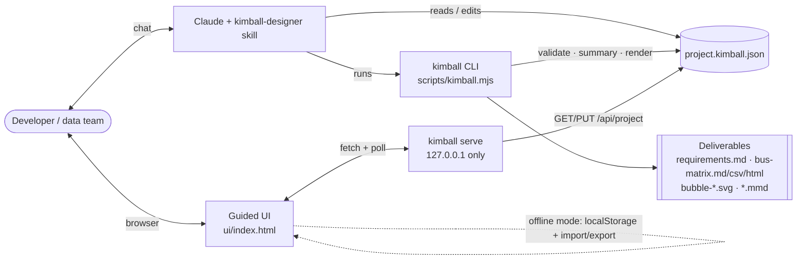

# Architecture

Kimball Designer is **one TypeScript code base** that produces three deliverables, all centred on a single project file.



## Components

| Component | Path | Runtime | Responsibility |
|---|---|---|---|
| **Core engine** | `src/core/` | Pure TS (browser + Node) | Types, factories, normalisation, JSON Schema, validation rules, phase status, bus matrix derivation, bubble layout, exporters (Markdown, CSV, HTML, SVG, Mermaid), coach guidance content, example projects, zip writer |
| **Guided UI** | `src/app/` | Browser (React 18) | Phase stepper, editors for each phase, coach panel, bubble diagram & bus matrix views, review/export, persistence & sync |
| **CLI** | `src/cli/` | Node ≥ 18 | `init`, `validate`, `summary`, `render`, `serve` |
| **Sync server** | `src/cli/server.ts` | Node ≥ 18 | Serves the single-file UI and a small JSON API for the project file |
| **Skill** | `plugin/skills/kimball-designer/` | Claude | `SKILL.md` workflow, `references/`, `examples/`, `schema/`, plus the **built** `scripts/kimball.mjs` and `ui/index.html` |

## Build outputs

| Command | Output | Notes |
|---|---|---|
| `npm run dev` | Vite dev server | Hot reload for UI work |
| `npm run build:web` | `dist/` | Hosted UI (optional GitHub Pages) |
| `npm run build:skill` | `plugin/skills/kimball-designer/ui/index.html`, `…/scripts/kimball.mjs`, `…/schema/*.json`, `…/examples/*.json` | **Committed**. CI rebuilds and fails on drift so the skill always matches the source. |

## The project file

`*.kimball.json` is the single source of truth (see [ADR-001](DECISIONS.md#adr-001-a-single-project-file-is-the-source-of-truth)). Shape (v1):

```text
KimballProject
├── schemaVersion: "1.0"
├── meta: name, purpose, sponsor, scopeIn, scopeOut, successCriteria[], currentPhase, createdAt, updatedAt
├── stakeholders[]: id, name, role, type, interviewStatus, notes
├── requirements[]: id, statement, kpis[], priority, stakeholderIds[], processIds[]
├── processes[]: id, name, description, owner, sourceSystems[], grain, factTableType,
│                businessValue, feasibility, facts[], dimensions[] (dimensionId + roles[])
├── dimensions[]: id, name, kind, description, attributes[] (name, description, scdType), hierarchies[]
├── assumptions[]: id, text
└── openQuestions[]: id, text, owner, status
```

The bus matrix and the bubble diagrams are **derived** from `processes[].dimensions[]` — there is no separate matrix to keep in sync.

## Live sync protocol

`kimball serve <file>` binds to `127.0.0.1` and exposes:

| Method & path | Purpose |
|---|---|
| `GET /` | The single-file UI |
| `GET /api/health` | `{ ok, file, version }` — the UI uses this to detect "connected" mode |
| `GET /api/project` | Project JSON (`ETag` = file mtime) |
| `GET /api/project/meta` | `{ mtimeMs }` — polled every ~2 s to detect edits made by Claude |
| `PUT /api/project` | Validates JSON and writes atomically (temp file + rename) |

Requests whose `Host` is not `127.0.0.1:<port>`/`localhost:<port>` or whose `Origin` is foreign are rejected (DNS-rebinding protection). Bodies are capped at 5 MB.

Conflict handling: the UI debounces saves (~600 ms). When a poll reports a newer mtime than the last write the UI made, it reloads from disk if there are no unsaved local edits, otherwise it asks the user which version to keep.

## UI structure

```text
src/app/
├── main.tsx, App.tsx          shell: header, stepper, phase outlet, coach panel
├── store/                     store (immer + undo), persistence (localStorage, file, server sync)
├── phases/                    one component per phase
├── components/                form controls, list editors, BubbleDiagram, BusMatrixGrid, PriorityGrid…
└── styles/                    app.css (consumes brand/tokens.css)
```

Navigation is hash-based (`#/phase/grain`) so the single HTML file works from `file://`.

## Quality gates

- `npm run typecheck` — strict TypeScript
- `npm test` — Vitest unit tests for core, CLI and server; component tests for key UI pieces
- `npm run build:skill` + `git diff --exit-code` — committed skill bundles are current
- Playwright end-to-end tests (M4)
