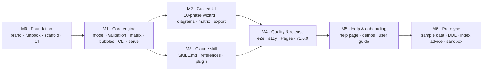

# Roadmap

The plan to v1.0. Each milestone maps to a [GitHub milestone](https://github.com/kristinnthor/Kimball-designer/milestones); progress is tracked in [#1](https://github.com/kristinnthor/Kimball-designer/issues/1).

## M0 · Foundation
Brand identity (#2), runbook & tracker (#3), architecture & ADRs (#4), repo hygiene (#5), toolchain scaffold (#6), CI (#7).

## M1 · Core engine
Project model & JSON Schema (#8), validation rules (#9), bus matrix + exporters (#10), bubble layout + SVG/Mermaid (#11), requirements document (#12), CLI (#13), local sync server (#14).

## M2 · Guided UI
Shell & stepper (#15), store & live sync (#16), Discover phases (#17), business processes + prioritisation (#18), grain (#19), dimensions (#20), facts (#21), bubble diagram view (#22), bus matrix view (#23), review & export (#24), coach content (#25), examples (#26), single-file build (#27).

## M3 · Claude skill
SKILL.md workflow (#28), references (#29), interview question bank (#30), plugin packaging (#31), evaluation scenarios (#32).

## M4 · Quality & release
Playwright e2e (#33), accessibility (#34), hosted UI on GitHub Pages at kimball.kristinn.eu (#35), v1.0.0 release (#36).

## M5 · Help & onboarding
In-app Help page that explains what the process delivers (#45), guided demos with a step-by-step demo bar (#46), and a user guide generated from the same content for GitHub and the skill (#47).

## M6 · Prototype and review
Owner requests after M5: readable open questions (#49), varied example text (#50), stakeholders as owners (#51), the Prototype phase with sample data and a Docker sandbox (#52), CREATE TABLE scripts with index recommendations (#53), fixes from a full product review (#54), UI polish (#56), saving the prototype query that answers each requirement (#58), and a generated dbt project (#60).

## After v1.0 (ideas, not scheduled)
- Detailed design phase: attribute-level dimension design, SCD strategy per attribute, source-to-target mapping.
- Load (ETL/ELT) templates from source to the star schema; SQL DDL (#53) and a dbt project with models, tests and seeds (#60) are done.
- Import from existing warehouse metadata (information_schema, dbt manifest).
- Multi-user collaboration on one project file.
