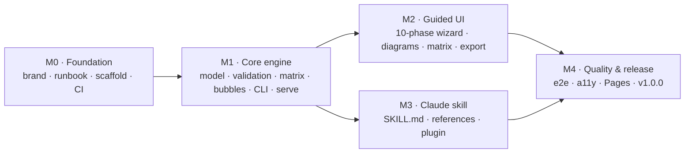

# Roadmap

The plan to v1.0. Each milestone maps to a [GitHub milestone](https://github.com/kristinnthor/Kimball-designer/milestones); progress is tracked in [#1](https://github.com/kristinnthor/Kimball-designer/issues/1).

## M0 · Foundation
Brand identity (#2), runbook & tracker (#3), architecture & ADRs (#4), repo hygiene (#5), toolchain scaffold (#6), CI (#7).

## M1 · Core engine
Project model & JSON Schema (#8), validation rules (#9), bus matrix + exporters (#10), bubble layout + SVG/Mermaid (#11), requirements document (#12), CLI (#13), local sync server (#14).

## M2 · Guided UI
Shell & stepper (#15), store & live sync (#16), Discover phases (#17), business processes + prioritisation (#18), grain (#19), dimensions (#20), facts (#21), bubble diagram view (#22), bus matrix view (#23), review & export (#24), coach content (#25), examples (#26), single-file build (#27).

## M3 · Claude skill
SKILL.md workflow (#28), references (#29), interview question bank (#30), plugin packaging (#31), evaluation scenarios (#32).

## M4 · Quality & release
Playwright e2e (#33), accessibility (#34), GitHub Pages — owner opt-in (#35), v1.0.0 release (#36).

## After v1.0 (ideas, not scheduled)
- Detailed design phase: attribute-level dimension design, SCD strategy per attribute, source-to-target mapping.
- Generate starter DDL (dbt models / SQL) from the bus matrix and bubble diagrams.
- Import from existing warehouse metadata (information_schema, dbt manifest).
- Multi-user collaboration on one project file.
