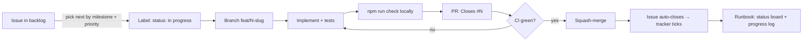

# Process runbook

How Kimball Designer is being built, how to monitor it, and what to do when something goes wrong.

> **Owner:** @kristinnthor · **Delivery agent:** Claude (Claude Code) · **Started:** 2026-11-01

---

## 1. Monitor in 60 seconds

| Question | Where to look |
|---|---|
| What's done / left? | 📋 [Delivery tracker (#1)](https://github.com/kristinnthor/Kimball-designer/issues/1) — boxes tick automatically when issues close |
| What's happening right now? | [Issues labelled `status: in progress`](https://github.com/kristinnthor/Kimball-designer/issues?q=is%3Aopen+label%3A%22status%3A+in+progress%22) and [open PRs](https://github.com/kristinnthor/Kimball-designer/pulls) |
| Is the build green? | [Actions → CI](https://github.com/kristinnthor/Kimball-designer/actions/workflows/ci.yml) |
| Is the hosted UI up to date? | [kimball.kristinn.eu](https://kimball.kristinn.eu) · [Actions → Pages](https://github.com/kristinnthor/Kimball-designer/actions/workflows/pages.yml) (deploys on every push to `main`) |
| What needs **me**? | [Issues labelled `needs: owner decision`](https://github.com/kristinnthor/Kimball-designer/issues?q=is%3Aopen+label%3A%22needs%3A+owner+decision%22) and [§ 5 below](#5-decisions-awaiting-the-owner) |
| What's blocked? | [Issues labelled `status: blocked`](https://github.com/kristinnthor/Kimball-designer/issues?q=is%3Aopen+label%3A%22status%3A+blocked%22) |
| Milestone progress | [Milestones](https://github.com/kristinnthor/Kimball-designer/milestones) |
| What happened, in order? | [§ 7 Progress log](#7-progress-log) |

## 2. Status board

> **Current status (2026-11-01):** M0–M3 and M5 are done, and the hosted UI is live at [kimball.kristinn.eu](https://kimball.kristinn.eu) with a full Help page and guided demos (#45–#47). The last open item, #36 (tag v1.0.0 after a live install test), is **your decision**; see § 5.

Updated with every merged PR. Legend: ✅ done · 🔄 in progress · ⏳ not started · ⛔ blocked · 🙋 needs owner

| Milestone | Status | Issues |
|---|---|---|
| **M0 · Foundation** | ✅ | #2 brand · #3 runbook · #4 architecture · #5 hygiene · #6 scaffold · #7 CI |
| **M1 · Core engine** | ✅ | #8 model · #9 validation · #10 bus matrix · #11 bubble · #12 req. doc · #13 CLI · #14 serve |
| **M2 · Guided UI** | ✅ | #15 shell · #16 store/sync · #17 discover · #18 processes · #19 grain · #20 dimensions · #21 facts · #22 bubble UI · #23 matrix UI · #24 review · #25 coach · #26 examples · #27 single-file |
| **M3 · Claude skill** | ✅ | #28 SKILL.md · #29 references · #30 interview guide · #31 plugin · #32 evals |
| **M4 · Quality & release** | 🙋 | #33 e2e ✅ · #34 a11y ✅ · #35 Pages ✅ · #36 release 🙋 |
| **M5 · Help & onboarding** | ✅ | #45 help page · #46 guided demos · #47 user guide |

## 3. How work flows



### 3.1 Picking work
1. Lowest open milestone first (M0 → M4).
2. Inside a milestone: `priority: P0` → `P1` → `P2`, respecting "Depends on #N" in the issue body.
3. Closely related issues may be delivered in one PR; the PR lists every `Closes #N`.

### 3.2 Branches and commits
- Branch: `feat/<issue>-<slug>`, `fix/<issue>-<slug>`, `docs/<issue>-<slug>`, `chore/<issue>-<slug>`.
- Commits: [Conventional Commits](https://www.conventionalcommits.org/) — `feat(core): derive bus matrix (#10)`.
- `main` is always releasable; no direct pushes except the initial bootstrap commit.

### 3.3 Pull requests
- Template: `.github/pull_request_template.md` (summary, issues closed, how verified, screenshots).
- Must pass **CI**: typecheck, unit tests, build, skill-bundle drift check.
- **Sourcery review** (a third-party app installed on the account) also comments on PRs. It is advisory and non-blocking: its findings are triaged, and the useful ones are fixed in the same or the next PR.
- Merge method: **squash**. Branch deleted after merge.
- During autonomous sessions Claude merges its own PRs once CI is green ([ADR-009](DECISIONS.md#adr-009-autonomous-delivery-workflow)). Every merge is recorded in the progress log, so it can be reviewed afterwards and reverted if needed.

### 3.4 Labels

| Label | Meaning |
|---|---|
| `type: feature / docs / chore / test / tracking` | Kind of work |
| `area: core / ui / skill / brand / ci / process` | Part of the system |
| `priority: P0 / P1 / P2` | Required / important / nice to have for v1.0 |
| `status: in progress` | Someone is actively working on it |
| `status: blocked` | Waiting on something — the issue says what |
| `needs: owner decision` | Requires @kristinnthor |
| `by: claude` | Implemented by Claude |

### 3.5 Definition of done
- Acceptance criteria in the issue are met (checkboxes ticked or explained).
- Tests cover new logic; `npm run check` passes.
- Docs updated (README / skill references / CHANGELOG `Unreleased`).
- UI changes: screenshot in the PR.

## 4. Local commands

```bash
npm ci                 # install
npm run dev            # UI dev server (http://localhost:5173)
npm test               # unit tests
npm run typecheck      # strict TypeScript
npm run build:skill    # rebuild ui/index.html + scripts/kimball.mjs inside the skill (also runs build:docs)
npm run build:docs     # regenerate docs/USER-GUIDE.md + the skill reference from src/core/help.ts
npm run check          # everything CI runs (except e2e)
npx playwright install chromium  # once
npm run test:e2e       # Playwright: wizard, live sync, axe accessibility
```

## 5. Decisions awaiting the owner

| # | Decision | Claude's recommendation | Default if no answer |
|---|---|---|---|
| D1 | **Licence** | MIT (most permissive, common for dev tools) | MIT |
| D2 | **Brand approval** — name, logo, palette in [`brand/BRAND.md`](../brand/BRAND.md) | Approve as is | Keep as is |
| D3 | ✅ **Hosted UI on GitHub Pages** (#35). Decided 2026-11-01: live at [kimball.kristinn.eu](https://kimball.kristinn.eu); Pages source is *GitHub Actions* and `DEPLOY_PAGES=true` | — | — |
| D4 | ✅ **Social preview image**. Uploaded by the owner on 2026-11-01 | — | — |
| D6 | **Cut v1.0.0** (#36) — first do a live install test (`/plugin marketplace add kristinnthor/Kimball-designer`, then ask Claude to start a project), then run `node scripts/bump-version.mjs 1.0.0`, `npm run build:skill`, commit, `git tag v1.0.0`, `git push --follow-tags`. The release workflow publishes the zip. | Release after your smoke test | Stays at 0.1.0 |
| D5 | **Branch protection on `main`** (require CI + PR) — needs admin; would stop the agent from merging if reviews are required | Require CI only, not reviews, until v1.0 | Unprotected |

## 6. Troubleshooting

| Symptom | Likely cause | Fix |
|---|---|---|
| CI fails at **"skill bundle is up to date"** | Source changed but `npm run build:skill` output wasn't committed | Run `npm run build:skill`, commit the changed files under `plugin/skills/kimball-designer/` |
| Test *matches the generated files in the repository* fails | Help content in `src/core/help.ts` changed but the guide wasn't regenerated | `npm run build:docs`, commit `docs/USER-GUIDE.md` and `references/user-guide.md` |
| CI fails on typecheck only on CI | Different Node/TS version locally | Use Node 20+ and `npm ci` (lockfile) |
| `kimball serve` says port in use | Another serve instance | `--port 4179`, or stop the other process |
| UI shows "Offline mode" when served | Opened `ui/index.html` via `file://` instead of the served URL | Use the URL printed by `kimball serve` |
| UI and file disagree | Edited in both places within ~2 s | The UI prompts to keep *disk* or *browser* version; choose, then continue |
| Skill doesn't trigger in Claude | Plugin not installed/enabled | `/plugin` → check `kimball-designer`; or copy the skill folder to `~/.claude/skills/` |
| kimball.kristinn.eu shows a blank page | Pages source switched back to *Deploy from a branch*, which serves the unbuilt source `index.html` | Settings → Pages → Source *GitHub Actions*, then re-run the *Pages* workflow |
| Pages workflow is *skipped* | Repository variable `DEPLOY_PAGES` isn't `true` | Settings → Secrets and variables → Actions → Variables |
| HTTPS certificate error on kimball.kristinn.eu | GitHub hasn't issued the certificate for the custom domain yet (up to 24 h after DNS is set) | Wait, then tick Settings → Pages → *Enforce HTTPS* |

## 7. Progress log

Newest first. Every merged PR adds a line.

| When (UTC) | What | Link |
|---|---|---|
| 2026-11-01 | Help & onboarding (owner request): Help page explaining what the process delivers, guided demos with a demo bar, user guide generated for GitHub and the skill (#45–#47) | [#48](https://github.com/kristinnthor/Kimball-designer/pull/48) |
| 2026-11-01 | Hosted UI live at kimball.kristinn.eu (#35): owner set the custom domain and uploaded the social preview; Pages source switched to GitHub Actions, `DEPLOY_PAGES=true`, Open Graph tags, no `kimball serve` probe off localhost | [#44](https://github.com/kristinnthor/Kimball-designer/pull/44) |
| 2026-11-01 | Owner actions posted on #35 (Pages) and #36 (v1.0.0); tracker #1 updated | [#1](https://github.com/kristinnthor/Kimball-designer/issues/1) |
| 2026-11-01 | Merged: quality & release — Playwright e2e, axe a11y (both themes), Pages workflow (gated), release workflow, social preview PNG (#33, #34; #35/#36 ready for owner) | [#42](https://github.com/kristinnthor/Kimball-designer/pull/42) |
| 2026-11-01 | Merged: Claude skill — SKILL.md, references, interview guide, plugin marketplace, evals (#28–#32) | [#41](https://github.com/kristinnthor/Kimball-designer/pull/41) |
| 2026-11-01 | Merged: guided UI — 10 phases, coach, bubble diagrams, bus matrix, review/export, live sync; core review fixes (#15–#27) | [#40](https://github.com/kristinnthor/Kimball-designer/pull/40) |
| 2026-11-01 | Merged: `kimball` CLI and `kimball serve` live-sync server (#13, #14) | [#39](https://github.com/kristinnthor/Kimball-designer/pull/39) |
| 2026-11-01 | Merged: core engine — model, JSON Schema, validation (16 rules), bus matrix, bubble diagrams, requirements doc, 3 example projects (#8–#12) | [#38](https://github.com/kristinnthor/Kimball-designer/pull/38) |
| 2026-11-01 | Merged: toolchain scaffold + CI (#6, #7) | [#37](https://github.com/kristinnthor/Kimball-designer/pull/37) |
| 2026-11-01 | Bootstrap: branding, runbook, architecture, ADRs, methodology, roadmap, templates (#2–#5) | [e46070f](https://github.com/kristinnthor/Kimball-designer/commit/e46070f) |
| 2026-11-01 | Backlog created: 5 milestones, 35 issues, 18 labels; tracker pinned | [#1](https://github.com/kristinnthor/Kimball-designer/issues/1) |

## 8. Resuming work (for the agent or a new contributor)

1. Read this runbook, [ARCHITECTURE.md](ARCHITECTURE.md) and [DECISIONS.md](DECISIONS.md).
2. Open the [tracker](https://github.com/kristinnthor/Kimball-designer/issues/1); pick the next unchecked issue per § 3.1.
3. Check for open PRs and `status: in progress` issues first — finish or hand those over before starting new work.
4. Follow § 3; update § 2 and § 7 in the same PR that completes the work.

## 9. Release procedure (v1.0 and later)

1. All M0–M3 issues closed; M4 `P0`/`P1` closed.
2. Update `CHANGELOG.md` (move *Unreleased* to the version), bump `package.json` and `plugin/.claude-plugin/plugin.json`.
3. Run `node scripts/bump-version.mjs X.Y.Z` and `npm run build:skill`, add release notes in `docs/releases/vX.Y.Z.md`, commit, then tag `vX.Y.Z` on `main` and push with `--follow-tags`. The release workflow checks versions, builds, tests and attaches `kimball-designer-skill-X.Y.Z.zip`. Dry run: run the *Release* workflow manually.
4. Announce install commands in the release notes.
