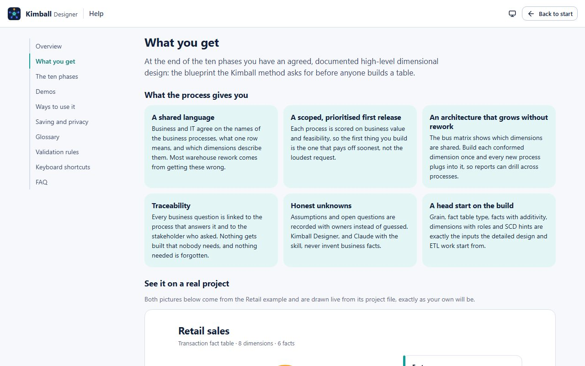
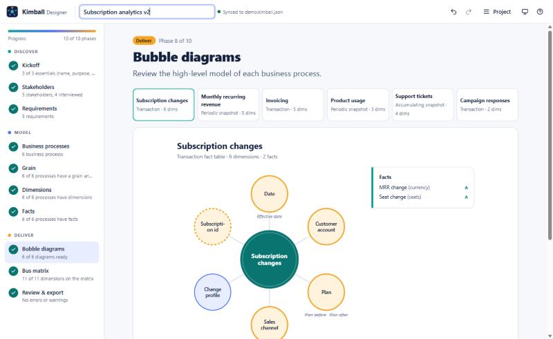
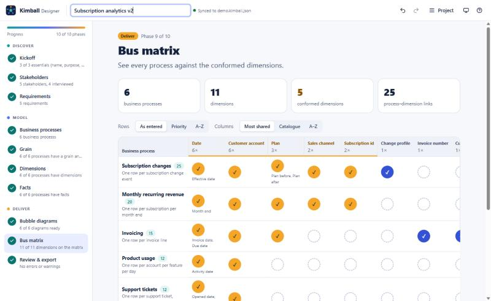
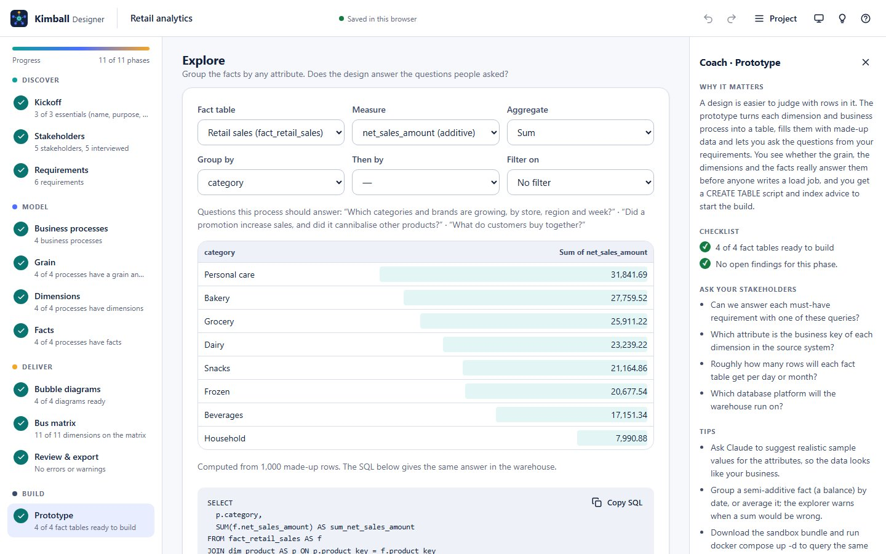
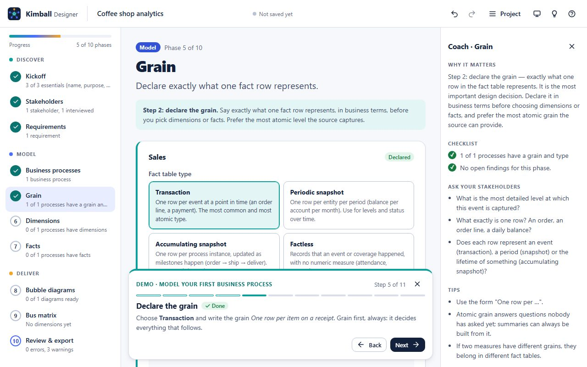

# Kimball Designer user guide

<!-- Generated from src/core/help.ts by `npm run build:docs`. Do not edit by hand. -->

From first interview to bus matrix. Try it at [kimball.kristinn.eu](https://kimball.kristinn.eu); the same guide is in the app under **Help**.

1. [Overview](#overview)
2. [What you get](#what-you-get)
3. [The eleven phases](#the-eleven-phases)
4. [Demos](#demos)
5. [Ways to use it](#ways-to-use-it)
6. [Saving and privacy](#saving-and-privacy)
7. [Glossary](#glossary)
8. [Validation rules](#validation-rules)
9. [Keyboard shortcuts](#keyboard-shortcuts)
10. [FAQ](#faq)

## Overview

Kimball Designer guides you through the **business-requirements stage of the Kimball method**: the short, disciplined process that comes before anyone designs a table. You interview the business, find the business processes that produce the numbers, declare their grain, and agree which dimensions they share.

It works in your browser, inside Claude as a skill, or both at once, and ends with the two pictures every Kimball project needs: a **bubble diagram** per business process and the **enterprise bus matrix**. A last, optional step turns the design into tables with sample data to explore, a CREATE TABLE script with index advice, and a Docker sandbox.

**Who it is for**

- **Data and BI engineers** starting a new warehouse, lakehouse or data mart.
- **Analytics engineers** who want a model the business has agreed to before writing dbt models.
- **Data architects** planning conformed dimensions across teams.
- **Business analysts and product owners** running requirements workshops.

The work is split into eleven short phases in four stages. **Discover** captures the business context, **Model** applies Kimball’s four-step design (process, grain, dimensions, facts), **Deliver** turns it into diagrams, a matrix and documents, and **Build** lets you try the design on sample data and get the SQL to build it. The coach panel explains each phase as you go, and the stepper shows how far you are.

## What you get

After the first ten phases you have an agreed, documented high-level dimensional design: the blueprint the Kimball method asks for before anyone builds a table. The Prototype phase then gives you a first physical version of it to try out.



### What the process gives you

- **A shared language.** Business and IT agree on the names of the business processes, what one row means, and which dimensions describe them. Most warehouse rework comes from getting these wrong.
- **A scoped, prioritised first release.** Each process is scored on business value and feasibility, so the first thing you build is the one that pays off soonest, not the loudest request.
- **An architecture that grows without rework.** The bus matrix shows which dimensions are shared. Build each conformed dimension once and every new process plugs into it, so reports can drill across processes.
- **Traceability.** Every business question is linked to the process that answers it and to the stakeholder who asked. Nothing gets built that nobody needs, and nothing needed is forgotten.
- **Honest unknowns.** Assumptions and open questions are recorded with owners instead of guessed. Kimball Designer, and Claude with the skill, never invent business facts.
- **A head start on the build.** Grain, fact table type, facts with additivity, dimensions with roles and SCD hints are exactly the inputs the detailed design and ETL work start from.

### The deliverables

#### Bubble diagrams

One picture per business process: the process (the future fact table) in the middle, the dimensions that describe it around it, and the grain underneath. *(SVG, PNG, Mermaid · `bubbles/<process>.svg`, `.mmd`)*



- The business process and its fact table type.
- Every dimension it uses, with role names (for example *Order date* and *Ship date* for one Date dimension).
- Conformed dimensions highlighted in amber, so shared pieces stand out.
- The grain statement: what one row represents.

**Who uses it:** Business stakeholders, to confirm "yes, this is how we think about orders". Modellers, as the starting point for the detailed design.

**Why it matters:** It is the simplest model a non-technical person can check. Mistakes caught here cost minutes; caught after the build, they cost weeks.

**Where:** Phase 8 *Bubble diagrams*, `kimball render`, and inside the requirements document as Mermaid.

#### Enterprise bus matrix

Business processes as rows, dimensions as columns, and a mark wherever a process uses a dimension. *(Markdown, CSV, HTML · `bus-matrix.md`, `.csv`, `.html`)*



- Every business process with its grain.
- Every dimension, most-shared first; conformed columns highlighted.
- Role names in the cells where a dimension plays several roles.
- Optional ordering by priority, so the matrix doubles as a delivery plan.

**Who uses it:** Architects and data engineers, to plan which dimensions to build once and share. Programme managers, to plan releases one row at a time.

**Why it matters:** It is the architecture of the whole warehouse on one page. Columns with many marks are the conformed dimensions that make cross-process reporting possible.

**Where:** Phase 9 *Bus matrix*, `kimball render`, and section 6 of the requirements document.

#### Requirements document

The written record of everything agreed, ready for sign-off or a pull request. *(Markdown · `requirements.md`)*

- Overview: purpose, sponsor, scope in and out, success criteria.
- Stakeholders and interview status.
- Business requirements with priority, KPIs, who raised them, which processes answer them and, once you use the prototype, the query that answers each one.
- Each business process with grain, fact table type, dimensions, facts and its bubble diagram.
- The dimension catalogue with kinds, key attributes, hierarchies and where each is used.
- The bus matrix, the prioritisation, assumptions and open questions.

**Who uses it:** The sponsor, to sign off. The whole team, as the reference during the build.

**Why it matters:** Decisions made in workshops fade quickly. A document that traces every requirement to a process keeps the team honest.

**Where:** Phase 10 *Review & export* and `kimball render`.

#### Prioritisation grid

Each business process plotted by business value against feasibility, both scored 1 to 5. *(In the UI and the requirements document)*

- Four quadrants: *Build first*, *Valuable but hard*, *Easy, lower value* and *Later*.
- The score (value × feasibility) for each process.

**Who uses it:** The sponsor and the delivery lead, to choose the first release.

**Why it matters:** Kimball recommends delivering one business process at a time. The grid makes that choice explicit and defensible.

**Where:** Phase 4 *Business processes* and section 7 of the requirements document.

#### Validation report

The model checked against 18 Kimball best-practice rules, each with a hint on how to fix it. *(In the UI, `kimball validate` (text or `--json`))*

- Errors (broken references, missing names), warnings (no grain, no date dimension, unused dimensions) and notes.
- A link from each finding to the phase where you fix it.

**Who uses it:** Whoever runs the process, before sharing anything.

**Why it matters:** It catches the classic mistakes early: processes without a grain, facts without dimensions, dimensions nobody shares.

**Where:** Phase 10 *Review & export*, the coach panel checklist, and `kimball validate`.

#### Assumptions and open questions

What you assumed and what you still need to find out, each question with an owner. *(In the UI and the requirements document)*

- Assumptions such as "the fiscal calendar is 4-4-5".
- Open and answered questions with owners.

**Who uses it:** The team, as a to-do list before the detailed design.

**Why it matters:** Unknowns written down get answered. Unknowns left in someone’s head become wrong assumptions in production.

**Where:** Phase 3 *Requirements* and the requirements document.

#### Project file

The single source of truth behind every deliverable above, described by a JSON Schema. *(JSON · `<project>.kimball.json`)*

- Everything you entered: scope, stakeholders, requirements, processes, dimensions, facts, assumptions and questions.

**Who uses it:** You, to save and share work. Git, to version it. Claude and the `kimball` CLI, to read and update it.

**Why it matters:** Diagrams and matrices are always regenerated from this file, so they can never disagree with each other.

**Where:** Project menu → *Export project file*, or the file `kimball serve` keeps in sync.

#### Prototype: sample data, SQL and a sandbox

Your design as a star schema filled with made-up rows, a CREATE TABLE script with index advice, and a PostgreSQL sandbox for Docker. *(In the UI · `schema.sql`, `index-recommendations.md`, `docker-compose.yml`, CSV · `kimball prototype`, `kimball ddl`)*



- One table per dimension (surrogate key, business key, type 2 history columns) and one per business process (a key per dimension role, the facts).
- Sample rows you can group and filter in the browser, with the matching SQL.
- The question that answers each requirement, saved with it: the requirements document shows it and `queries.sql` gets its SQL.
- CREATE TABLE scripts for PostgreSQL, SQL Server or Snowflake, with keys and indexes, and recommendations for later (columnstore, BRIN, partitioning, clustering).
- A Docker Compose sandbox that loads the tables and data on first start.

**Who uses it:** Data engineers starting the build, and the business users who want to see how their questions will be answered.

**Why it matters:** Problems with the grain or missing dimensions show up in minutes with rows in front of you, instead of after the first load job.

**Where:** Phase 11 *Prototype*, or `kimball prototype` and `kimball ddl` from the CLI. Claude can suggest realistic sample values for your attributes.

#### Claude hand-off summary

A compact progress summary you can paste into Claude to continue the work there. *(Plain text)*

- Progress per phase, open findings and what to do next.

**Who uses it:** Anyone moving between the browser and Claude.

**Why it matters:** Claude picks up exactly where you left off, without re-explaining the project.

**Where:** Phase 10 *Review & export* → *Copy summary*, or `kimball summary`.

### What happens next

- Build the conformed dimensions first: the columns with the most marks in the bus matrix.
- Pick the top process on the prioritisation grid and do its detailed design: every attribute, slowly changing dimension strategy and source-to-target mapping.
- Try it in phase 11 *Prototype* first: query the sample data, save the question that answers each must-have requirement, and start from the generated CREATE TABLE script.
- Build and release that one process end to end, then the next row of the matrix.
- Keep the project file in your repository and update it when scope changes, so the diagrams stay current.

### Not included

Kimball Designer covers the high-level design and a first physical prototype. It does not produce:

- A finished physical design: the CREATE TABLE script is a starting point to review, not production-ready DDL.
- Source-to-target mappings and ETL or ELT code.
- Data profiling or connections to your source systems.
- Dashboards or reports.

## The eleven phases

| # | Phase | You do | You record | Done when |
|---|---|---|---|---|
| 1 | **Kickoff** | Agree with the sponsor why the warehouse exists and what is in scope. | Name, purpose, sponsor, scope in and out, success criteria. | Name, purpose and scope are filled in. |
| 2 | **Stakeholders** | List who to interview (executives, managers, analysts, source owners) and hold the interviews. | People, roles, interview status and notes. | Every interview is done or skipped, and at least one is done. |
| 3 | **Requirements** | Turn interview notes into business questions and KPIs. | Requirements with priority and KPIs, assumptions and open questions. | At least one requirement is recorded. |
| 4 | **Business processes** | Find the business events that produce the numbers, and score them. | Business processes, owners, source systems, value and feasibility, linked requirements. | At least one business process exists. |
| 5 | **Grain** | Declare exactly what one fact row represents, and the fact table type. | A grain statement ("One row per …") and a type per process. | Every process has a grain and a fact table type. |
| 6 | **Dimensions** | Ask who, what, where, when, why and how about one row, and reuse dimensions across processes. | The dimension catalogue, attributes, hierarchies, roles and which process uses what. | Every process has at least one dimension. |
| 7 | **Facts** | List the numeric measurements captured at the grain. | Facts with additivity, unit and description, or *factless*. | Every process has facts or is marked factless. |
| 8 | **Bubble diagrams** | Review each process as a bubble diagram with its stakeholders. | Nothing new: diagrams are drawn from your model. Click a bubble to edit it. | Every process has a diagram (at least one dimension). |
| 9 | **Bus matrix** | Check the processes against the shared dimensions and fill gaps. | Usage marks, toggled directly in the grid. | Every dimension is used by a process. |
| 10 | **Review & export** | Resolve the findings and export the deliverables. | Fixes; then download the files or hand off to Claude. | There are no errors or warnings. |
| 11 | **Prototype** | Explore the design as tables filled with sample data, save the question that answers each requirement, then download the CREATE TABLE script, index advice and a Docker sandbox. | The query that answers each requirement. Optional: the SQL dialect, sample row counts and dates, and per attribute a data type, business key and sample values. | Every process has a grain, dimensions and facts, so it can be built as a table. |

## Demos

In the app, open **Help → Demos** and press *Start*: a demo bar walks you through each step in the real UI and ticks steps off as you do them.

### Tour a finished model (3 min)

Walk through a complete retail project, from its purpose to the bus matrix, and see what every phase produces.

1. **Start with why** (Kickoff): Every project starts with a purpose and a scope agreed with the sponsor. This one gives merchandising and store operations one trusted view of sales, inventory, deliveries and online orders.
2. **Who was interviewed** (Stakeholders): Five people: an executive, two business managers, a BI analyst and the owner of the source systems. A balanced list stops both wishful thinking and technical tunnel vision.
3. **What they need to know** (Requirements): Their answers became six business questions with KPIs and priorities. Each one is linked to the business process that will answer it.
4. **The business processes** (Business processes): Four business events produce the numbers. Scroll to the prioritisation grid: *Retail sales* scores highest on value and feasibility, so it is built first.
5. **One row means…** (Grain): Each process declares its grain and fact table type. Sales is a *transaction* table, inventory a *periodic snapshot* and online fulfilment an *accumulating snapshot*.
6. **Dimensions, shared** (Dimensions): Eleven dimensions describe the processes. Amber ones, like Date, Product and Store, are **conformed**: several processes share them.
7. **The bubble diagrams** (Bubble diagrams): Each process as a picture business people can check. Switch between processes with the thumbnails, and click a bubble to edit that dimension.
8. **The bus matrix** (Bus matrix): The whole architecture on one page: processes against dimensions. Try *Priority* row order to read it as a delivery plan.
9. **Review and export** (Review & export): No errors or warnings; the few notes are judgement calls, like a dimension only one process uses. **Download all (.zip)** gives you the requirements document, the matrix and every diagram.

### Model your first business process (10 min)

Start from a blank project and model sales for a small coffee chain. Each step checks itself off when you have done it.



1. **Purpose and scope** (Kickoff): Fill in **Purpose**, for example *Know which products sell best in each shop, by hour*, and **In scope**: *Till sales in all shops*.
2. **Interview someone** (Stakeholders): Click **Add stakeholder**. Name *Ana*, role *Operations manager*. Set **Interview status** to *Done* and jot down a note.
3. **Write a business question** (Requirements): Click **Add requirement** and write *Which products sell best in each shop and hour?* Add the KPI *Units sold*.
4. **Add the business process** (Business processes): Under **Quick add**, click **Sales**. Score **Business value** 5 and **Feasibility** 4, and tick your question under **Answers requirements**.
5. **Declare the grain** (Grain): Choose **Transaction** and write the grain *One row per item on a receipt*. Grain first, always: it decides everything that follows.
6. **Pick the dimensions** (Dimensions): Quick-add **Date**, **Product** and **Location** (rename it *Shop* if you like). Then tick all three on the Sales card under **Dimensions per business process**.
7. **Add the facts** (Facts): Click **Add fact** twice: *Quantity* and *Sales amount* (unit *currency*). Both are **Additive**: they can be summed across every dimension.
8. **See your bubble diagram** (Bubble diagrams): There it is: Sales in the middle, the dimensions around it and the grain underneath. Download it as SVG or PNG to share.
9. **Share a dimension** (Business processes): Quick-add a second process, **Inventory snapshot**. Then, in **Dimensions**, tick Date, Product and Shop for it too. Those dimensions are now **conformed**.
10. **Read the bus matrix** (Bus matrix): Two rows now share the amber columns. That is the bus architecture: build each conformed dimension once, and every process can use it.
11. **Review and export** (Review & export): The review lists what is still missing, such as the grain and facts for Inventory. Fix what you like, then **Download all (.zip)**. You have just run the whole method in miniature.

### Share the results (2 min)

Export the diagrams, the matrix and the full deliverables pack. Uses your open project, or the SaaS example if none is open.

1. **Diagrams as images** (Bubble diagrams): Pick a process, then **SVG** for documents, **PNG** for slides or **Copy Mermaid** for wikis and pull requests (GitHub renders Mermaid).
2. **The matrix as a table** (Bus matrix): Download **CSV** for spreadsheets, **HTML** for a styled page, or **Copy Markdown** for a README.
3. **Everything at once** (Review & export): **Download all (.zip)** bundles the project file, the requirements document, the matrix in three formats and every bubble diagram.
4. **Keep the source**: Use **Project → Export project file** and commit the `.kimball.json` to your repository. Anyone can open it here, or regenerate the files with `kimball render`.

### Work with Claude (5 min)

Let Claude interview you while you watch the model grow in the browser. Needs Claude Code and Node 18 or later.

1. **Install the skill**: In Claude Code, add the marketplace and install the plugin:

   ```text
   /plugin marketplace add kristinnthor/Kimball-designer
   /plugin install kimball-designer@kimball-designer
   ```

2. **Ask for help**: Describe your project in plain words. Claude creates `kimball/project.kimball.json` and offers to open the guided UI on it.

   ```text
   Help me gather requirements for a sales data warehouse and build a bus matrix.
   ```

3. **Watch it live**: Claude starts `kimball serve`, which opens the guided UI on the same file. Answer Claude in the chat, or type in the browser: each side sees the other’s changes within about two seconds.

   ```text
   node <skill folder>/scripts/kimball.mjs serve kimball/project.kimball.json --open
   ```

4. **Get the deliverables**: When the model is ready, Claude validates it, writes the files and summarises the bus matrix, the conformed dimensions, what to build first and the blocking questions.

   ```text
   node <skill folder>/scripts/kimball.mjs render kimball/project.kimball.json --out kimball/out
   ```

## Ways to use it

### In your browser

*Best for:* Trying it out, workshops on a shared screen, people without developer tools.

- Open [kimball.kristinn.eu](https://kimball.kristinn.eu) and start a project or an example.
- Work through the phases; your project is saved in this browser as you type.
- Use **Project → Export project file** to keep a copy or share it.

### Offline, from one file

*Best for:* Locked-down networks and air-gapped machines.

- Open `plugin/skills/kimball-designer/ui/index.html` from the repository (or the installed skill) in any modern browser.
- It is the same app in a single HTML file, and needs no network at all.

### With Claude (the skill)

*Best for:* Being interviewed phase by phase, turning meeting notes into a model, and writing the deliverables into your repository.

- Install the plugin in Claude Code (see the *Work with Claude* demo).
- Ask Claude to help gather Kimball requirements. It asks at most three questions at a time and records your answers in the project file.
- Claude never invents business facts: anything unknown becomes an open question.

```text
/plugin marketplace add kristinnthor/Kimball-designer
/plugin install kimball-designer@kimball-designer
```

### Claude and the browser together

*Best for:* Talking to Claude while seeing the diagrams update, or clicking in the UI and letting Claude pick it up.

- `kimball serve` serves the guided UI on `localhost` and keeps it in sync with the project file.
- Edits from either side appear in the other within about two seconds. If both change the same file at once, the UI asks which version to keep.

```text
node plugin/skills/kimball-designer/scripts/kimball.mjs serve kimball/project.kimball.json --open
```

### Command line

The `kimball` CLI ships inside the skill and needs only Node 18 or later: `node plugin/skills/kimball-designer/scripts/kimball.mjs <command>`.

| Command | What it does |
|---|---|
| `init [file] --example retail` | Create a project file, optionally from an example (retail, saas, healthcare). |
| `serve [file] --open` | Open the guided UI on the file with live sync. |
| `summary <file>` | Progress per phase and what to do next. |
| `validate <file>` | Check the model against the Kimball rules (`--json`, `--strict`). |
| `render <file> --out <dir>` | Write the requirements document, bus matrix and bubble diagrams. |
| `ddl <file> --dialect postgres` | Print the CREATE TABLE script with keys and index advice (postgres, sqlserver, snowflake). |
| `prototype <file> --out <dir>` | Write the prototype bundle: Docker sandbox, scripts, sample data and index recommendations. |
| `guide [phase]` | Coaching notes for a phase: why, what to ask, tips and pitfalls. |
| `examples` | List the example projects. |

## Saving and privacy

- **In the browser.** Your project autosaves in this browser’s local storage as you type. It stays on this device only: clearing site data or using a private window removes it, so export a file to keep it.
- **As a file.** **Project → Export project file** downloads a `.kimball.json` file. **Open project file** loads one. The file is plain JSON, so it diffs nicely in Git.
- **With kimball serve.** The project file on disk is the source of truth, and the header shows which file you are synced to. If the file and the browser change at the same time, you choose which version wins.
- **Privacy.** Kimball Designer has no backend and no analytics. Nothing you type leaves your machine unless you export or share it yourself; `kimball serve` only listens on `localhost`.

## Glossary

- **Business process.** A business event that produces measurements, such as taking an order or shipping a parcel. Each becomes a fact table. Name it as a verb or event, not a department.
- **Grain.** What exactly one row of a fact table represents, for example *one row per product on a receipt*. Declared before dimensions and facts, because it decides both.
- **Fact.** A numeric measurement taken at the grain, such as quantity or sales amount.
- **Dimension.** The descriptive context of a fact: who, what, where, when, why and how. Product, Customer and Date are typical dimensions.
- **Conformed dimension.** A dimension shared by two or more business processes with the same meaning and keys. It is what lets reports drill across processes.
- **Role-playing dimension.** One dimension used in several roles by the same process, such as Date as *Order date* and *Ship date*.
- **Bus matrix.** A grid of business processes (rows) against dimensions (columns). The plan for an enterprise warehouse built one process at a time.
- **Bubble diagram.** A high-level picture of one business process with the dimensions that describe it. Used to agree the model with business people.
- **Transaction fact table.** One row per event at a point in time (an order line, a payment). The most common and most atomic type.
- **Periodic snapshot fact table.** One row per entity per period (balance per account per month). Use for levels and status over time.
- **Accumulating snapshot fact table.** One row per process instance, updated as milestones happen (order → ship → deliver). Has several date roles.
- **Factless fact table.** Records that an event or coverage happened, with no numeric measure (attendance, promotion coverage).
- **Additive fact.** Can be summed across every dimension (amount, quantity).
- **Semi-additive fact.** Can be summed across some dimensions but not time (balance, inventory on hand).
- **Non-additive fact.** Cannot be summed (unit price, ratio, percentage). Store the additive parts instead.
- **Date dimension.** Calendar dimension; often role-playing (order date, ship date).
- **Degenerate dimension.** A dimension key with no attributes kept in the fact table (order number, invoice number).
- **Junk dimension.** A grouping of low-cardinality flags and indicators.
- **Surrogate key.** A meaningless integer that identifies a dimension row. Facts join on it, so history (type 2) and source changes never break the joins.
- **Business key.** The identifier the source system uses, such as a customer number or SKU. Kept as a dimension attribute; also called the natural key.
- **Slowly changing dimension (SCD).** How a dimension attribute keeps history when it changes. Type 0: Retain original value; never changes. Type 1: Overwrite; no history kept. Type 2: Add a new row; full history kept. Type 3: Add a column for the prior value; limited history.

## Validation rules

Errors must be fixed, warnings usually should be, and notes are judgement calls. Details in [METHODOLOGY.md](https://github.com/kristinnthor/Kimball-designer/blob/main/docs/METHODOLOGY.md).

| Code | Severity | Rule |
|---|---|---|
| `KD001` | error | Project has a name |
| `KD002` | error | IDs are unique |
| `KD003` | error | References point to existing items |
| `KD101` | warning | Every process declares a grain |
| `KD102` | warning | Every process has at least one dimension |
| `KD103` | warning | Non-factless processes have at least one fact |
| `KD104` | warning | Factless processes have no facts |
| `KD105` | warning | Every dimension is used by a process |
| `KD106` | warning | Every requirement is linked to a process |
| `KD107` | warning | Names are unique |
| `KD108` | warning | Every process has a date dimension |
| `KD109` | warning | Saved requirement queries match the design |
| `KD201` | info | Grain is phrased "One row per …" |
| `KD202` | info | Dimension is used by a single process |
| `KD203` | info | Accumulating snapshots have several date roles |
| `KD204` | info | Planned interviews are not done yet |
| `KD205` | info | Process has no value/feasibility score |
| `KD206` | info | Must-have requirements are answered by a query |

## Keyboard shortcuts

| Keys | Action |
|---|---|
| Ctrl+Z (⌘Z on Mac) | Undo |
| Ctrl+Shift+Z or Ctrl+Y | Redo |
| Arrow keys | Move between cells in the bus matrix |
| Space or Enter | Toggle the focused bus matrix cell |
| Tab / Shift+Tab | Move through fields and buttons; every control works without a mouse |

## FAQ

**Do I need Claude to use Kimball Designer?**

No. The guided UI works on its own, online or from one offline file. Claude adds an interviewer that asks the right questions and writes the files into your repository.

**Does it generate SQL or table designs?**

Yes, as a starting point. Phase 11 *Prototype* turns the design into a star schema with a CREATE TABLE script for PostgreSQL, SQL Server or Snowflake, index recommendations, sample data and a Docker sandbox. Review data types and keys in the detailed design before you build for real.

**How long does the process take?**

The demo takes ten minutes. A real first business process usually takes a few interviews and one or two modelling workshops; the tool keeps each session focused.

**Can several people work on one project?**

Share the `.kimball.json` file, ideally in a Git repository. One person edits at a time; the file is plain JSON, so changes are easy to review.

**Where did my project go?**

It is saved in the browser you used. If you cleared site data or switched browsers, open your exported `.kimball.json` file instead.

**What do the colours mean?**

Teal is a business process (fact), blue a dimension and amber a conformed (shared) dimension, everywhere in the app and the exports.

**Can I start from my own notes?**

Yes. With the skill, paste interview notes into Claude and ask it to record them. In the browser, use the interview guide in the *Stakeholders* phase.

**Is this affiliated with the Kimball Group?**

No. Kimball Designer is an independent open-source project that implements techniques popularised by Ralph Kimball and the Kimball Group.
