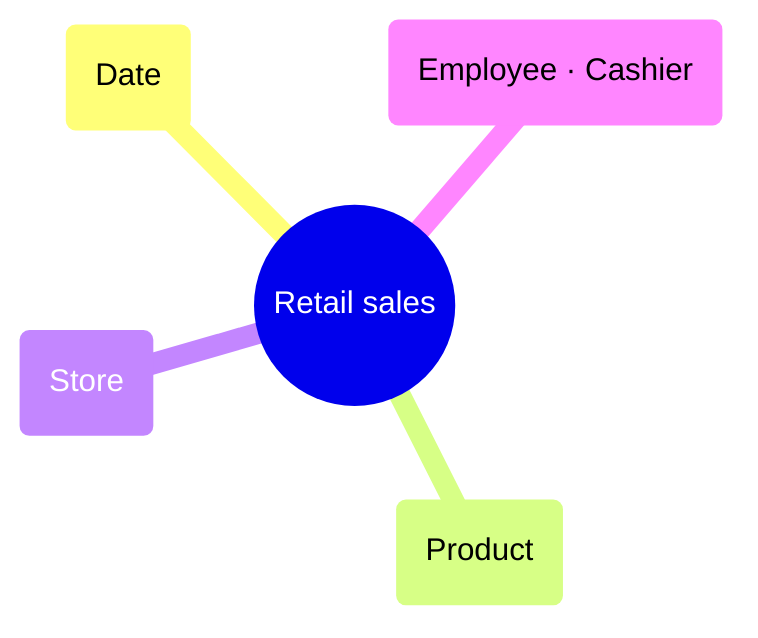

# Deliverables

## What `$KD render <file> --out <dir>` writes

| File | Content | Audience |
|---|---|---|
| `requirements.md` | Full requirements document: overview, stakeholders, requirements (R1…), processes with grain/dimensions/facts and Mermaid bubble diagrams, dimensions, bus matrix, prioritisation, assumptions and open questions, validation summary | Sponsor, team, repository |
| `bus-matrix.md` | Bus matrix as a GitHub table; conformed columns in bold; roles in parentheses | README, PRs |
| `bus-matrix.csv` | Same, with grain column; spreadsheet-safe | Spreadsheets |
| `bus-matrix.html` | Branded standalone page | Sharing, printing |
| `bubbles/<process>.svg` | Bubble diagram per process (light theme) | Slides, docs |
| `bubbles/<process>.mmd` | Mermaid `mindmap` source per process | Markdown docs |

Add `--theme dark` for dark SVG/HTML.

## Hand-off message template

```markdown
**<Project name> — high-level dimensional model is ready.** Files are in `kimball/out/`.

**Bus matrix**
<paste bus-matrix.md table>

**Conformed dimensions:** Date, Product, Store (used by 4 processes) — agree definitions and owners first.

**Build first:** <process> — business value <v>, feasibility <f>. <one-line reason>.

**Open questions blocking iteration 1:**
- <question> — <owner>

**Next steps:** detailed design of the conformed dimensions (attributes, SCD), source-to-target mapping for <process>, then build its fact table.
```

Keep it short; the documents carry the detail.

## Formats when Node isn't available

### Bus matrix (Markdown)

```markdown
| Business process | **Date** | **Product** | Store | Vendor |
| --- | :---: | :---: | :---: | :---: |
| Retail sales | X | X | X |  |
| Purchase order receipts | X (Order date, Receipt date) | X |  | X |

**Bold** = conformed dimension (used by two or more business processes). Roles in parentheses.
```

Columns: dimensions ordered by how many processes use them (most shared first). Bold a column when two or more processes use it, unless it is a degenerate dimension.

### Bubble diagram (Mermaid mindmap)



Avoid parentheses, brackets and quotes inside labels. Put the grain under the diagram as text: "Grain: One row per …".
